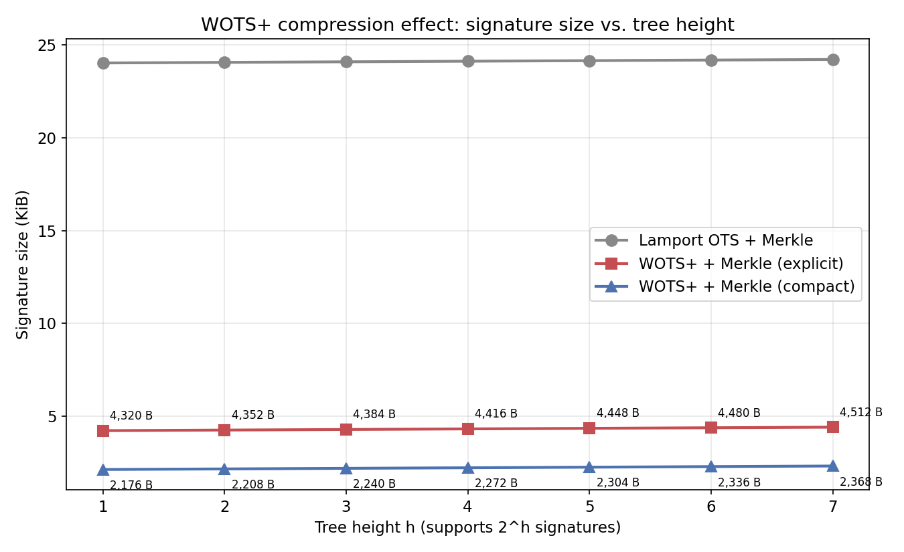
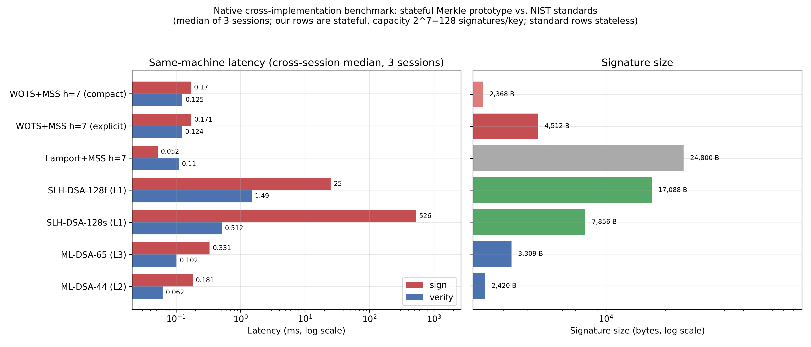

# An Implementation Audit of a Lamport–WOTS+–Merkle Post-Quantum Signature Prototype: Three Findings and a Comparison Against NIST Standards

**Abstract**

We present a **reproducible implementation audit** of a Lamport–WOTS+–Merkle post-quantum signature prototype. The study examines three engineering questions: the correctness of checksum encoding, the reconstruction of one-time-signature public keys from signatures, and the cost of a stateful Merkle construction.

*First*, we reproduce an implementation defect in an earlier checksum encoding: the routine decoded the checksum from a 32-byte zero-padded buffer, so the three checksum digits were always $(0,0,0)$, exposing the three checksum-chain secrets and defeating the WOTS+ checksum binding. We describe the failure mechanism, provide boundary tests over the full legal range, and confirm the corrected encoding—which, for this parameter set, coincides with the RFC 8391 / FIPS 205 encoding—using an independently implemented verifier that rebuilds the public key from the signature. *Second*, we quantify the effect of reconstructing the one-time-signature public key during verification: under the stated serialization convention and tree height seven, the prototype's core signature size falls from 4,512 B to 2,368 B for WOTS+-inspired signatures, and we contrast this with the full-public-key commitment used by the raw Lamport construction. *Third*, we measure signing, verification, key-generation, and state-management costs under a documented protocol, and compare the prototype with PQClean's ML-DSA/SLH-DSA on the same machine; these are reported as measurements of the tested implementations, not as security or general performance rankings.

The prototype is **not claimed to conform to FIPS 205**, and **no cryptographic security level or new security proof is claimed**. The contribution is a reproducible audit method, a reproduced encoding defect with an independent-verifier cross-check, and a characterization of the engineering trade-offs of compact stateful hash-based signatures—motivated by BIP-0360 (P2MR), with no protocol-level integration claimed.

---

## 1. Introduction

The arrival of cryptographically relevant quantum computers (CRQCs) would invalidate the elliptic-curve discrete logarithm problem on which Bitcoin's secp256k1 signatures rest. Shor's algorithm [1] solves the discrete logarithm problem in polynomial time, allowing a quantum adversary to recover private keys from public keys exposed on chain. Migration timelines come from several distinct sources that should not be conflated: NIST's IR 8547 (an *initial public draft*) [2] offers transition-planning guidance and deprecation intent for standardized algorithms; NSA's Commercial National Security Algorithm Suite (CNSA) 2.0 sets its own milestone schedule for national-security systems; and individual agencies impose requirements through separate administrative directives. We cite these only as motivation. None is a universal mandate, no single deadline should be attributed to NIST alone, and no claim in this paper depends on any particular timeline.

Post-quantum signatures fall into four families: lattice-based (ML-DSA/Falcon), hash-based (SLH-DSA/XMSS/LMS), code-based (Classic McEliece), and multivariate/isogeny-based (SQIsign). Among these, hash-based signatures rest on comparatively weak and well-studied assumptions about the underlying hash function—typically (second-)preimage resistance and, depending on the construction and its proof, collision resistance—rather than on structured algebraic problems, and they have the longest track record, dating to Lamport's 1979 construction [3] and Merkle's 1989 tree aggregation [4]. Realizing that assumption in practice additionally requires construction-level care: domain separation, keyed or address-separated hash invocations, and an explicit security model (§4). A bare "collision- and preimage-resistant hash function" statement is therefore a motivation for choosing the family, not a guarantee about any particular instantiation—including this one.

BIP-0360 (Pay-to-Merkle-Root, P2MR) [5] is a proposed soft fork that removes the key-path spend from Taproot (BIP-341 [6]), leaving a script-tree output type that commits to a 32-byte Merkle root. P2MR is itself *not* a post-quantum signature; it is a shell that (i) avoids long-exposure leakage of secp256k1 public keys and (ii) reserves the `OP_SUCCESSx` upgrade path for future post-quantum signature opcodes. This paper implements and benchmarks the hash-based signature layer that such a shell would host.

### 1.1 What this paper is

This is an **implementation audit, not a new construction**. We built a Lamport–WOTS+–Merkle prototype, then tried to break it: we re-implemented the primitives independently, cross-checked the known-answer vector, measured the prototype against PQClean's ML-DSA/SLH-DSA on the same machine, and implemented the state-management requirements rather than only describing them. The audit produced three findings.

### 1.2 Three findings

**F1 — Correctness: a checksum defect that round-trip tests cannot catch.** During the audit we found that the first implementation encoded the WOTS+ checksum as `base_w(c.to_bytes(32,'big'), 3)`. Because $c \le 960$ fits in two bytes, the 32-byte buffer is zero-padded and the routine reads leading zero nibbles, so the checksum was always $(0,0,0)$: the three checksum chains were revealed at position 0 (the secret itself) and the binding was silently defeated. Sign and verify shared the same wrong encoding, so all round-trip and tamper tests passed. We fixed the encoding (`wots_checksum`), added boundary tests, regenerated the vectors, and added an **independent** verifier that rebuilds the public key from the signature and now rejects a forgery that raises a message digit. The general lesson: for hash-based signatures, a passing round-trip test is not evidence of correctness; an independent implementation is required.

**Encoding clarification (the defect is a buffer read, not a non-standard encoding).** The *corrected* checksum encoding is the plain three-base-16-digit decomposition of $c$ ($c_0=\lfloor c/256\rfloor$, $c_1=\lfloor(c\bmod 256)/16\rfloor$, $c_2=c\bmod 16$). For this parameter set ($w=16$, $\text{len2}=3$) this is **mathematically identical** to the RFC 8391 / FIPS 205 checksum encoding, which left-shifts $c$ by $8-(\text{len2}\cdot\log_2 w \bmod 8)=4$ bits before taking $\text{len2}$ digits. The defect was therefore a *zero-padded-buffer read*, not a deviation from the standard encoding; the fix restores the standard-consistent decomposition (verified exhaustively over $c\in[0,960]$ in `tests/test_checksum.py`, `test_custom_encoding_matches_rfc8391_for_this_parameter_set`).

**F2 — Compaction: WOTS+ can drop the OTS public key, raw Lamport cannot.** In the standard XMSS/WOTS-Merkle construction the verifier recovers the OTS public key from the signature (`pk_i = chain(sig_i, d_i, w−1−d_i)`), so the 2,144 B OTS public key need not be transmitted. For WOTS+ at $h=7$ this reduces the signature from 4,512 B to **2,368 B** (≈10.5× smaller than Lamport). Raw Lamport cannot use the same optimization: its leaf commits to the full OTS public key $H(\text{pk}[0] \,\|\, \text{pk}[1])$, while a Lamport signature reveals only the preimages for the actual bit values, so the other half is unrecoverable. The asymmetry is a concrete design trade-off, not a generic claim.

**What is and is not new here.** OTS-public-key reconstruction is *not* a contribution of this paper: it is the `pkFromSig` step already specified in RFC 8391 and in the WOTS+ component of FIPS 205. Our contribution is the evidence surrounding it in one audited codebase—an explicit encoding specification for both formats, a demonstration that explicit and compact signatures verify identically across the tested matrix, a byte-level size accounting asserted against the constants the code actually uses (Table 6, row 12), and a measurement of what compaction does and does not cost (it removes 2,144 B of transmission at no verification cost, §3.3.2). We therefore position F2 as reproducible engineering evidence about a known technique, not as a new cryptographic primitive or optimization.

**Scope of the claim (F2).** This is an *encoding and transmission-size* optimization, not a cryptographic security contribution. OTS-public-key reconstruction is defined for WOTS+ in RFC 8391 and for the WOTS+ component of FIPS 205 (the latter additionally specifies address handling and public-key compression); we reuse the reconstruction principle only. The prototype remains non-conformant with FIPS 205 and claims no security level (§1.3).

**F3 — Performance: the Python/C gap is small, and stateful WOTS+MSS is competitive on sign/verify but pays on keygen.** In a same-machine native C benchmark (PQClean ML-DSA/SLH-DSA versus a C port of the prototype), the Python/C gap is only **~1.3–1.5×**, not 10–100×, because `hashlib` is already C and both implementations are dominated by thousands of small SHA-256 calls. Stateful WOTS+MSS signs/verifies in ~0.17/0.12 ms, the same order as ML-DSA-44 (~0.18/0.06 ms) and far faster than SLH-DSA (25.02/1.49 ms for 128f; 526.27/0.51 ms for 128s, cross-session medians of Table 4), at the cost of stateful key generation (~32–33 ms) and a 128-signature capacity. This quantifies the stateful/stateless trade-off rather than asserting a Pareto advantage.

### 1.3 Scope and non-claims

The prototype is **not FIPS 205 conformant**: it uses unkeyed, prefix-separated SHA-256 rather than the standard's keyed functions with address separation. We claim **no security level**: a 256-bit hash is associated with a 128-bit goal, but no EU-CMA reduction, reduction-loss quantification, or multi-target analysis is given for this concrete instantiation. Size comparisons are descriptive and compare stateful with stateless schemes; they are not a performance or security ranking and not a Pareto claim. BIP-0360 is motivation, not evidence of deployability. These boundaries are detailed in §3.4, §4, and §7.

**Threat model.** This paper is an implementation audit, not a security evaluation of a deployed scheme. The adversary modelled is an *auditor* seeking correctness or implementation flaws (e.g., the F1 checksum defect); the prototype is a research artifact without a production trust model. No reduction to concrete attack cost is therefore claimed, and the findings are scoped to the implementation and its tests rather than to the WOTS+ or Merkle constructions in general.

## 2. Background

### 2.1 Quantum threats to ECC

Two attack windows matter for on-chain public keys:

- **Long-exposure attacks**: public keys embedded in spent or unspent outputs (e.g., P2PK, P2TR internal keys) are exposed indefinitely. An attacker has as much time as the funds remain at that address. These are the first attacks a CRQC would enable.
- **Short-exposure attacks**: while a transaction sits unconfirmed in the mempool, its public key is exposed for minutes. Exploiting this requires a faster CRQC; protection requires post-quantum signature schemes.

BIP-0360 addresses long-exposure attacks by committing only to a hash of a script tree. This paper addresses the signature scheme that the script tree will eventually verify.

### 2.2 Hash-based signatures

A one-time signature (OTS) signs exactly one message; reusing a key pair leaks the private key. Lamport OTS [3] uses 256 secret/public pairs, one per bit of the message digest; the signer reveals one preimage per bit. Merkle [4] aggregates $N = 2^h$ OTS public keys into a hash tree whose root is the overall public key. A signature consists of the OTS signature, the OTS public key, and the Merkle authentication path; in the standard XMSS/WOTS-Merkle construction the OTS public key is *reconstructed from the signature* rather than transmitted (finding F2, §1.2).

WOTS (Winternitz OTS) compresses Lamport by encoding the message digest in base-$w$ digits and using hash chains; a checksum prevents existential forgery. WOTS+ as standardized in FIPS 205 [7] uses a keyed internal function and address separation; our implementation follows the *structure* of WOTS+ but omits the keyed function and address separation (see §4).

### 2.3 NIST standards

FIPS 204 (ML-DSA) [8] standardizes lattice-based signatures at NIST security levels 2, 3, and 5. FIPS 205 [7] standardizes **SLH-DSA**, a complete *stateless hash-based signature scheme* derived from SPHINCS+ [16]; it does **not** standardize WOTS+ as a standalone, general-purpose signature primitive—WOTS+ appears only as an internal component of SLH-DSA, for which the standard additionally specifies address handling and public-key compression. RFC 8391 [9] standardizes stateful XMSS and RFC 8554 [12] standardizes stateful LMS. Representative parameter sets are listed in Table 2.

### 2.4 Related work

The components used here are all long-standardized or well studied. The Winternitz transform was proposed by Winternitz [13] and refined to WOTS+ (with a keyed checksum and keyed hash chains) by Hülsing [14]; XMSS [15], LMS (RFC 8554 [12]), and SPHINCS [16] build stateful and stateless Merkle/forest aggregations on top of WOTS+; XMSS and LMS are themselves standardized (RFC 8391 [9], RFC 8554 [12]), while the later SPHINCS+ variant of this line underlies the SLH-DSA construction standardized in FIPS 205 [7]. Merkle's original tree-authentication signature dates to 1987/1989 [4], [17]. Relative to this body of work, our contribution is the audit and the three findings in §1.2—a same-codebase measurement of the Winternitz effect (Lamport vs. WOTS+), the compaction asymmetry, and a native performance comparison—rather than a new primitive or proof. Prior engineering studies of hash-based signatures tend to focus on either a single standardized scheme or on cross-language micro-benchmarks; we instead isolate the Winternitz gain and the OTS-public-key-reconstruction optimization (§3.3.2) under one implementation, which is the part of the design space most relevant to a compact, stateful on-chain commitment.

## 3. Design

### 3.1 Lamport OTS

For $n = 32$ bytes (SHA-256 output), the key generation samples $2 \times 256$ secrets $x^{(b)}_i \in \{0,1\}^{256}$ for $b \in \{0,1\}$, $i \in [0,256)$, and publishes $y^{(b)}_i = H(x^{(b)}_i)$. To sign, the digest bits $m_i \in \{0,1\}$ select which preimage to reveal. Verification recomputes the hashes and compares against the public array.

Sizes: secret key 16,384 B, public key 16,384 B, signature 8,192 B.

### 3.2 WOTS+

Following the parameter style of FIPS 205 [7], we use $n = 32$ bytes, base $w = 16$ (4 bits per digit): `len1 = 64` message chains, `len2 = 3` checksum chains, `len = 67` total chains. The construction follows the *structure* of WOTS+ but, as stated in §4, omits the keyed function and address separation of the standard.

#### 3.2.1 Message and checksum encoding

The message digest is $\mu = H_{\text{msg}}(m) = \text{SHA-256}(\texttt{"HBS-PQ-MSG-v1"} \mathbin\| m)$, a 32-byte (256-bit) value. It is converted to `len1 = 64` base-$w$ digits by a `base_w` routine that processes the digest bytes **big-endian and, within each byte, takes four-bit digits most-significant-nibble first**; the 256 bits therefore map exactly to 64 digits with no padding or leftover bits. The checksum is
$$c = \sum_{i=0}^{\text{len1}-1}(w-1-d_i), \qquad 0 \le c \le \text{len1}\,(w-1) = 960,$$
and is encoded as `len2 = 3` base-16 digits, **most-significant digit first**, by the integer decomposition
$$c_0 = \lfloor c/16^2\rfloor,\quad c_1 = \lfloor (c \bmod 16^2)/16\rfloor,\quad c_2 = c \bmod 16,$$
i.e. exactly the 3-digit base-16 representation of $c$ (so $c=960$ yields $(3,12,0)$ and $c=0$ yields $(0,0,0)$). The full digit vector is $D = (d_0,\dots,d_{63},c_0,c_1,c_2)$ of length `len = 67`. Signer and verifier use the identical encoding, so the KAT vector (Appendix A) is reproducible from the stated algorithm alone.

> **F1 in detail: the checksum defect.** The initial implementation encoded the checksum as `base_w(c.to_bytes(32,'big'), 3)`. Because $c\le 960$ fits in two bytes, the 32-byte big-endian representation is zero-padded and `base_w` reads those leading zero nibbles, so the checksum was *always* decoded as $(0,0,0)$—the three checksum chains were revealed at position 0 (the secret itself) and the WOTS+ checksum binding was silently defeated. The defect is fixed in the current code (`wots_checksum` in `wots.py`, with boundary self-tests for $c\in\{0,1,15,16,255,256,960\}$) and the signatures/vectors below were regenerated. The fix is cross-checked by the independent verifier `ref_verify.py` (Appendix C) **and by an exhaustive differential audit against an independently implemented RFC 8391 reference encoder** (`experiments/audit_checksum_rfc.py`): the reference follows RFC 8391 Algorithm 1 (base_w) and Algorithm 5 (WOTS_sign) *verbatim*—`csum = \sum_{i=0}^{63}(15-d_i)`, byte-alignment shift `csum << (8 - ((len_2 \cdot lg(w)) \bmod 8)) = csum << 4`, `len_2{=}2`-byte big-endian pack, then base_w extraction—and matches `wots_checksum` for **every $c\in[0,960]$ (961/961, zero mismatches)**; PQClean's `wots.c` (`sphincs-sha2-128s-simple/clean`, commit `0586a82`) uses the identical shift/pack/extract path. The reference encoder and the implementation under audit use structurally different routes (RFC bit-extraction after a byte-alignment shift vs. an integer base-16 decomposition), so agreement cannot originate from a shared algorithmic assumption. Evidence with per-value outputs for all 961 values, the boundary cases, and the reproduced pre-fix constant `[0,0,0]`: `results/checksum_rfc_audit.json`. We report it here because it illustrates precisely why a "passing round-trip test" does not validate a hash-based signature: sign and verify share the same (wrong) encoding and both accept.
>
> **Equivalence note (do not mislabel the fix).** The corrected decomposition is exactly what RFC 8391 / FIPS 205 produce for this $(w,\text{len2})=(16,3)$ after their 4-bit left shift: the exhaustive audit above verifies this for **all** $c\in[0,960]$ against the independent RFC 8391 reference (boundary examples: $c=1,16,255,256,960$ give $(0,0,1),(0,1,0),(0,15,15),(1,0,0),(3,12,0)$ in both). The audit therefore does **not** claim the prototype used a "non-standard checksum"; it claims a *wrong* computation that read the wrong three digits from a zero-padded buffer. The fix is a restoration of the standard-consistent encoding, not a new one.
>
> **Scope of the claim (F1) — quantified end to end.** This is an *implementation-level* failure of checksum encoding, not evidence that the WOTS+ construction itself is insecure. Rather than assert the impact, we measure it (`experiments/experiment_checksum_forgery.py`, results in `experiments/forgery_results.json`), because a test in which sign and verify share one encoder proves nothing:
>
> - **The leak is exactly three chain secrets and nothing else.** Over 10 independent keys the buggy signature contained `sk[64..66]` *verbatim* in **10/10** cases (the checksum chains are revealed at position 0, i.e. at the secret itself); the fixed signature did so in **0/10**.
> - **Round-trip testing was indeed misleading.** Buggy signatures were accepted by the buggy verifier in **20/20** keys (row A) but rejected by the *independent* verifier in **20/20** (row B)—confirming the shared-error explanation rather than any correctness. Fixed signatures passed both (rows C, D: **20/20**), and a single-byte tamper was rejected (**0/20**).
> - **Universal forgery from one signature is negligible.** A WOTS+ forgery can only *advance* chains, so it requires all 64 message digits of the target to dominate the revealed digits. Modelling the digits as independent and uniform over $\{0,\dots,15\}$, that event has probability $(\tfrac{136}{256})^{64}\approx2.6\times10^{-18}$. We state this as an **analytic quantity derived under that model**, not as an empirically measured rate: the Monte-Carlo search (0 hits in 20,000 message pairs) is consistent with it and rules out rates above roughly $10^{-4}$, but a 20,000-trial experiment cannot by itself establish—or refute—a probability of order $10^{-18}$.
> - **Under key reuse the leak becomes a genuine forgery.** Given 32 signatures from one reused key, the attacker takes the lowest revealed position per chain, finds a dominating target message, and produces a signature that the **independent verifier accepts**; the identical attack against the fixed implementation is **blocked**, because the required checksum retreat is impossible.
>
> The bounded conclusion is: per signature the defect discloses three of 67 chain secrets—not universal forgery; that disclosure escalates to a verifier-accepted forgery once the one-time key is reused, which §6.2 addresses as a separate, independently enforced failure mode.

#### 3.2.2 Hash chain

A chain is an iterated, fixed-input hash:
$$\text{chain}(x,\text{start},\text{steps}) = \bigl(H(\texttt{"WOTS-CHAIN"} \mathbin\| \cdot)\bigr)^{\text{steps}} \text{ applied starting at offset start},$$
i.e. `x` is fed through $H(\texttt{"WOTS-CHAIN"} \mathbin\| x)$ exactly `steps` times, with no keyed mask. The public key stores the chain *end* $\text{pk}_i = \text{chain}(\text{sk}_i,0,w-1)$ for each of the 67 secrets. A signature reveals, for each chain, $\text{sig}_i = \text{chain}(\text{sk}_i,0,d_i)$; verification recomputes $\text{chain}(\text{sig}_i,d_i,w-1-d_i)$ and accepts only if it equals $\text{pk}_i$ for all $i$. This is the unkeyed, prefix-separated chain—not FIPS 205's keyed $F$ function with address input—so it inherits none of that standard's multi-target security argument.

#### 3.2.3 Serialization and sizes

Secret key, public key, and signature are each the concatenation of `len = 67` values of $n = 32$ bytes, giving $67\times 32 = 2{,}144$ B each.

#### 3.2.4 WOTS+ sign / verify (pseudocode)

```
gen():    sk_i <-$ {0,1}^{256} for i in 0..66 ;  pk_i = chain(sk_i, 0, 15)
sign(m):  μ = H_msg(m) ;  D = base_w(μ,64) || checksum_digits(Σ(15-d_i))
          return [ chain(sk_i, 0, D[i])  for i in 0..66 ]
verify(m, sig, pk):
          if len(sig) != 67 or len(pk) != 67: return False
          D = base_w(H_msg(m), 64) || checksum_digits(Σ(15-d_i))
          for i in 0..66:
             if chain(sig[i], D[i], 15-D[i]) != pk[i]: return False
          return True
checksum_digits(c):  c0=floor(c/256), c1=floor((c mod 256)/16), c2=c mod 16   # 3 base-16 digits, MSB-first
```

### 3.3 Merkle signature scheme

For tree height $h$, we generate $N = 2^h$ OTS key pairs and aggregate them into a binary hash tree whose root (32 B) is the overall public key.

#### 3.3.1 Leaf and node hashing

- **Leaf:** $\ell_k = H(\texttt{"MSS-LEAF"} \mathbin\| \text{pk}^{\text{flat}}_k)$, where $\text{pk}^{\text{flat}}_k$ is the OTS public key serialized as in §3.2.3 (WOTS+: $67\times 32$ B; Lamport: $\text{pk}[0] \mathbin\| \text{pk}[1]$, 16,384 B).
- **Internal node:** $\text{node}(L,R) = H(\texttt{"MSS-NODE"} \mathbin\| L \mathbin\| R)$.

The tree is built bottom-up; the single remaining hash is the public root.

#### 3.3.2 On-the-wire signature and size convention

A Merkle signature at leaf index $k$ is the ordered tuple
$$ \sigma = \big(\text{OTS sig},\; \text{OTS pk},\; \text{auth path},\; k\big), $$
with field lengths: OTS sig = `len`$\times n$ B, OTS pk = `len`$\times n$ B, authentication path = $h \times n$ B, and leaf index $k$ encoded in $\lceil h/8\rceil$ bytes (framing). For WOTS+ at $h=7$ the core fields total $2{,}144 + 2{,}144 + 224 = 4{,}512$ B, and the full wire object including the 1-byte index is 4,513 B. In the size tables we report the *core* on-the-wire MSS signature (OTS sig + OTS pk + auth path) and omit the index/framing overhead; the $\lceil h/8\rceil$-byte index is added under a fixed-width convention (1 B at $h \le 8$).

**Compact mode (OTS public key rebuilt from the signature).** In the standard XMSS/WOTS-Merkle construction the verifier recovers the OTS public key from the signature alone via `pk_i = chain(sig_i, d_i, w-1-d_i)` (FIPS 205, `pkFromSig`) and therefore the OTS public key need **not** be transmitted. For WOTS+ this is fully applicable: every chain endpoint is reconstructable from the signature and the message, so the WOTS+ OTS public key (2,144 B) can be dropped, giving a compact on-the-wire size of $2{,}144 + 224 = 2{,}368$ B at $h=7$ (Table 2, "WOTS+MSS compact"). Verification cost is **unchanged**, which is the point worth stating precisely: explicit verification evaluates `chain(sig_i, d_i, w-1-d_i)` for all 67 chains and compares against the transmitted public key, whereas compact verification performs exactly the *same* 67 chain evaluations as `pkFromSig` and then authenticates the reconstructed leaf against the Merkle root. Both perform one forward pass over the 67 chains (≈510 hash calls for a typical digit vector), so compaction saves 2,144 B of transmission at no verification cost (Table 3: 0.167 ms compact vs 0.166 ms explicit at $h{=}7$; Table 4: 0.125 ms vs 0.124 ms in C). An earlier revision of the Python harness additionally re-ran the OTS verification against the key it had just reconstructed—an identity comparison that doubled compact verify time and produced the previously reported "≈1,000 extra hash calls"; that double pass was a measurement artifact, not a property of compaction. **Raw Lamport does not admit this optimization under the leaf commitment used here**: the leaf commits to the *full* OTS public key $H(\text{pk}[0] \mathbin\| \text{pk}[1])$, but a Lamport signature reveals only the preimages for the actual bit values, so the other 256 public values are not recoverable; the OTS public key must therefore be transmitted (24,800 B at $h=7$). **This is a statement about this commitment convention, not about Lamport in general.** A construction that committed to the Lamport OTS public key differently—for example, by Merkle-hashing the two halves so that each half can be recomputed from the revealed preimages, or by committing only to the half selected by the message—could support an analogous compaction. We therefore report the asymmetry as a property of the two designs *as instantiated here*, not as a limitation of every Lamport variant. This asymmetry—WOTS+ benefits from compaction under this convention, raw Lamport does not—is itself a concrete engineering finding of this study. Compact mode is implemented in the benchmark harness (`experiment_v2.GenericMSS`), which reports both explicit and compact rows in Table 3; the deployment API (`hbs_signature.MerkleSignatureScheme`) implements the raw Lamport variant only, for which the leaf commitment used here makes compaction inapplicable (see above).

#### 3.3.3 Verification and error handling

Verification (i) checks the inner OTS signature, (ii) recomputes the leaf hash from the OTS public key—either the transmitted one (explicit mode) or one rebuilt from the signature and message via `pkFromSig` (compact mode, §3.3.2)—and (iii) walks the authentication path to the root, comparing to the public root. Concrete guards: the OTS `verify` returns `False` on a length mismatch (truncated or malformed input); the Merkle `verify` rejects any signature whose OTS layer fails, whose `auth_path` length differs from the tree height, or whose recomputed root differs from the public root; an out-of-range `k` (leaf index) is likewise rejected; and `sign` raises an error on an out-of-range or already-used leaf index (§6). Pseudocode (compact-aware; `h` = tree height):

```
verify(m, σ, root):
   if not (0 <= σ.k < 2^h): return False          # F3: bind leaf index
   if len(σ.authpath) != h:  return False         # F3: bind auth-path length
   if σ.otspk is present:                          # explicit mode
       ots_pk = σ.otspk
   else:                                           # compact mode (F2 fix)
       ots_pk = pkFromSig(m, σ.otssig)             # chain(sig_i, d_i, w-1-d_i)
   if not OTS.verify(m, σ.otssig, ots_pk): return False
   cur = H("MSS-LEAF" || ots_pk_flat)
   idx = σ.k
   for sib in σ.authpath:
      cur = H("MSS-NODE" || (cur,sib if idx even else sib,cur))
      idx = idx >> 1
   return cur == root
```

**On-the-wire size convention.** In the comparison tables, "signature size" means the *core* on-the-wire MSS signature = OTS signature + OTS public key + authentication path. The OTS-only sizes reported in §3.1–3.2 (`sig` = OTS signature alone) are a separate, smaller quantity and are not what is transmitted. In compact mode $\sigma.\text{otspk}$ is absent and the verifier first rebuilds it from the signature and message (§3.3.2) before computing the leaf hash.

### 3.4 Security assumption and scope

SHA-256 is assumed second-preimage and collision resistant; a 256-bit hash is *associated with* a ~128-bit post-quantum goal, but this is a **parameter-selection target, not a proof** for this construction. We give no EU-CMA reduction, no reduction-loss quantification, and no multi-target analysis; the unkeyed, prefix-separated construction does not inherit FIPS 205's security argument. Finding F1 is a concrete reminder that a construction can pass every round-trip test while a security-critical encoding is wrong. The scope of the claims is stated once in §1.3.

## 4. Implementation

The implementation is in Python 3, using only the standard library (`hashlib.sha256`, `os.urandom`). Four modules:

- `hbs_signature.py` — Lamport OTS and generic Merkle scheme;
- `wots.py` — WOTS+ with `base_w`, `wots_checksum`, and `chain` functions;
- `experiment_v2.py` — benchmark harness supporting both OTS backends and compact mode;
- `ref_verify.py` — independent verifier (re-implements the primitives, rebuilds the public key from the signature, cross-checks the KAT).

We use plain SHA-256 with prefix-based domain separation (`"WOTS-CHAIN"`, `"MSS-LEAF"`, `"MSS-NODE"`) rather than the keyed PRF/F/H/H_msg construction of production SPHINCS+. This makes the implementation **inspired by**, not **conformant with**, FIPS 205. Three relationships should be distinguished:

- *Same basic idea*: hash chains and Merkle trees.
- *Reference design*: parameter choices or algorithm flow inspired by FIPS 205.
- *Conformant implementation*: meets the standard's algorithms, parameters, internal functions, address separation, and processing rules.

Our work supports the first two relationships only. The concrete differences are summarized in Table 1.

| Aspect | FIPS 205 (SLH-DSA / WOTS+) | This prototype |
|---|---|---|
| Internal function | Keyed `F`/`H`/`H_msg` with address (`ADRS`) | Unkeyed `SHA-256` with string prefixes |
| Domain separation | Per-chain, per-step addresses | Single prefix per function role |
| Message digest | Randomized `H_msg` (seed + message) | Deterministic `SHA-256(msg)` |
| Security proof | Reduces to hash assumptions | Not provided (target level only) |
| Conformance | Standardized | Research prototype, non-conformant |

Table 1: Relationship between this prototype and FIPS 205.

Known-answer tests use a deterministic DRBG (SHA-256 in counter mode) seeded with `HBS-PQ-WOTS-KAT-v1-2026`; vectors are serialized to `kat_wots.json`.

## 5. Experimental Results

### 5.1 Setup

Benchmarks run on the host described in Appendix B (Apple M1, macOS 15.7.7, CPython 3.14.7). Each data point is the median of **31 repetitions**, reported with the interquartile range (IQR); we deliberately exceed the minimum sample size because sub-millisecond Python operations are sensitive to garbage collection, scheduler migration, and CPU frequency scaling. The timed interval for each operation includes the full cryptographic work: for signing, the message digest, the OTS chain evaluations, and assembly of the OTS signature and authentication path; for verification, parsing the complete signature, the OTS verification, recomputation of the leaf hash, and the authentication-path walk to the root; for key generation, generation of all $2^h$ OTS key pairs and construction of the Merkle tree in a single process. **The Python latency figures in §5.2–5.3 are not directly comparable to native implementations; §5.5 provides a controlled native C benchmark in which both the prototype and the standard schemes are compiled in C on the same host.**

#### 5.1.1 Reproducibility and measurement protocol

All experiments are tied to a versioned source snapshot and a machine-readable manifest (`vectors/manifest.json`, generated by `experiments/make_manifest.py`). The manifest records the source revision, interpreter and compiler versions, compilation flags, the PQClean commit, the KAT DRBG seed, the test timestamp, and SHA-256 digests of the primary inputs. Correctness tests and performance measurements are conducted separately:

- **Correctness coverage** (§6.1, `tests/`): valid signatures; modified messages; malformed encodings; truncated signatures; invalid leaf indices; modified authentication paths; and consistency between explicit and compact formats. The checksum encoding is checked for equivalence with the RFC 8391 / FIPS 205 encoding over the entire legal range $[0,960]$ (`tests/test_checksum.py`).
- **Timing method**: all three harnesses—the standardized Python timer (`experiments/benchmark.py`), the native C harness, and the main Python harness (`experiment_v2.py`, Table 3)—apply the same 3-iteration warm-up (key generation, signing, verification) before timing, removing the earlier warm-up inconsistency between the Python and native measurements. `experiment_v2.py` additionally disables the Python garbage collector around the sub-millisecond sign/verify measurements so the median is not biased by GC pauses on an unpinned host, and embeds the raw per-iteration samples (`raw_key_gen_ms`, `raw_sign_ms`, `raw_verify_ms`) in `results_v2.json`. We report the median, interquartile range (IQR), **P95**, and a percentile-**bootstrap 95% confidence interval** for the median (2,000 resamples; `experiments/analyze_results.py`, output `results/bench_stats.csv`), so the precision of each point estimate is stated rather than implied; key generation, signing, verification, and state management are timed independently. For the $h{=}7$ configurations the bootstrap intervals are narrow (e.g. WOTS+MSS explicit verify: median 0.166 ms, P95 0.194 ms, 95% CI [0.1657, 0.1660] ms), so within a session the medians are stable; cross-session spread remains the dominant uncertainty and is reported separately for the native benchmark (§5.5).
- **Traceability**: every reported number is associated with the exact implementation and parameter set used to obtain it. Native C and Python results are kept in distinct files (`native_bench/`, `results_v2.json`) and never combined; the standardized Python timer is `experiments/benchmark.py`.

#### 5.2 Sizes

Table 2 compares on-the-wire sizes against standardized schemes.

| Scheme | Public key (B) | Signature (B) | Quantum-resistant? | State |
|---|---:|---:|---|---|
| secp256k1 Schnorr (BIP-340) [11] | 32 | 64 | No (Shor) | stateless |
| ML-DSA-44 (FIPS 204, NIST L2) [8] | 1,312 | 2,420 | Yes (standard) | stateless |
| ML-DSA-65 (FIPS 204, NIST L3) [8] | 1,952 | 3,309 | Yes (standard) | stateless |
| SLH-DSA-128s (FIPS 205, NIST L1) [7] | 32 | 7,856 | Yes (standard) | stateless |
| SLH-DSA-128f (FIPS 205, NIST L1) [7] | 32 | 17,088 | Yes (standard) | stateless |
| XMSS-SHA2_10_256 (RFC 8391, NIST L1) [9] | 64 | 2,500 | Yes (standard) | **stateful** |
| LMS_SHA256_M32_H10, w=8 (RFC 8554, NIST L1) [12] | 56 | 1,452 | Yes (standard) | **stateful** |
| This work: Lamport+MSS, h=7 | 32 | 24,800 | Intended for PQ use; security not established | **stateful** |
| This work: WOTS+MSS, h=7 (explicit) | 32 | **4,512** | Intended for PQ use; security not established | **stateful** |
| This work: WOTS+MSS, h=7 (compact) | 32 | **2,368** | Intended for PQ use; security not established | **stateful** |

Table 2: Public-key and signature sizes. Rows for *this work* and XMSS/LMS are **stateful** (ours supports $2^h\in\{2,\dots,128\}$ signatures per key); ML-DSA and SLH-DSA rows are stateless. Security levels are **not equivalent**: the standard rows are conformant and carry the standard's argument, while this work claims none (§1.3). The compact WOTS+MSS row omits the 2,144 B OTS public key, which the verifier rebuilds from the signature (§3.3.2); raw Lamport cannot do this. Sizes only; see §1.3 for why this is not a ranking.




### 5.3 Benchmark across heights

All latencies are Python-level (`time.perf_counter()`), median of 31 repetitions; the interquartile range (IQR, 75th–25th percentile) is shown in parentheses. The benchmark re-signs the same message/leaf for throughput timing and therefore does **not** exercise the one-time-use enforcement described in §6.2; it measures the cryptographic work, not a production signing loop.

| h | N | Keygen (ms) | Sign (ms) | Verify (ms) | Sig (B) |
|---:|---:|---:|---:|---:|---:|
| Lamport+MSS | | | | | |
| 1 | 2 | 1.30 (0.05) | 0.016 (0.000) | 0.100 (0.000) | 24,608 |
| 2 | 4 | 2.60 (0.17) | 0.017 (0.000) | 0.105 (0.000) | 24,640 |
| 3 | 8 | 5.10 (0.26) | 0.018 (0.000) | 0.099 (0.001) | 24,672 |
| 4 | 16 | 10.36 (0.22) | 0.021 (0.000) | 0.100 (0.001) | 24,704 |
| 5 | 32 | 20.60 (0.79) | 0.028 (0.002) | 0.101 (0.000) | 24,736 |
| 6 | 64 | 41.43 (0.44) | 0.039 (0.000) | 0.103 (0.000) | 24,768 |
| 7 | 128 | 82.86 (1.22) | 0.062 (0.002) | 0.101 (0.000) | 24,800 |
| WOTS+MSS | | | | | |
| 1 | 2 | 0.77 (0.02) | 0.185 (0.002) | 0.167 (0.006) | 4,320 |
| 2 | 4 | 1.53 (0.02) | 0.186 (0.001) | 0.165 (0.006) | 4,352 |
| 3 | 8 | 3.06 (0.05) | 0.188 (0.009) | 0.166 (0.001) | 4,384 |
| 4 | 16 | 6.28 (0.52) | 0.191 (0.008) | 0.165 (0.002) | 4,416 |
| 5 | 32 | 12.46 (0.10) | 0.199 (0.004) | 0.167 (0.007) | 4,448 |
| 6 | 64 | 24.92 (0.41) | 0.212 (0.004) | 0.166 (0.005) | 4,480 |
| 7 | 128 | 49.80 (0.34) | 0.234 (0.001) | 0.166 (0.001) | 4,512 |
| WOTS+MSS compact | | | | | |
| 1 | 2 | 0.76 (0.00) | 0.184 (0.007) | 0.164 (0.001) | 2,176 |
| 2 | 4 | 1.53 (0.04) | 0.193 (0.010) | 0.165 (0.001) | 2,208 |
| 3 | 8 | 3.12 (0.19) | 0.187 (0.001) | 0.166 (0.001) | 2,240 |
| 4 | 16 | 6.13 (0.24) | 0.192 (0.006) | 0.166 (0.001) | 2,272 |
| 5 | 32 | 12.48 (0.19) | 0.201 (0.001) | 0.169 (0.001) | 2,304 |
| 6 | 64 | 24.75 (0.11) | 0.212 (0.007) | 0.168 (0.002) | 2,336 |
| 7 | 128 | 49.93 (0.43) | 0.246 (0.014) | 0.167 (0.003) | 2,368 |

Table 3: Latency (median of 31 repetitions; IQR in parentheses, ms) and on-the-wire size across all measured tree heights. The harness applies a 3-iteration warm-up (key generation, signing, verification) identical to the native C benchmark (§5.5) and disables the Python garbage collector around the sub-millisecond sign/verify measurements, so the median is not biased by a cold first iteration or GC pauses on an unpinned host. WOTS+ costs ~0.17 ms extra signing time (hash chains) but cuts signature size by ~5.5× (explicit) or ~10.5× (compact, which omits the OTS public key). **Compact verification costs the same as explicit verification (0.167 ms vs 0.166 ms at $h{=}7$)**: a correctly implemented compact verifier runs `pkFromSig` once and then authenticates the reconstructed leaf against the Merkle root, which is exactly the same chain work that explicit verification performs against the transmitted public key. An earlier revision of the Python harness ran the chains a second time to re-check the signature against the key it had just reconstructed—an identity comparison that doubled the reported compact verify time; that double pass is removed here and was already absent from the C port. These are Python-level figures; for the same-machine native C comparison see §5.5.

### 5.4 Key observations

1. **Public key is 32 B** for both constructions, identical to secp256k1 and SLH-DSA. This is what makes Merkle-root commitment (BIP-341/0360) cheap on chain.
2. **WOTS+ compresses signatures by 5.5×** relative to Lamport (4,512 B vs. 24,800 B). The explicit WOTS+ size is dominated by the WOTS+ public key that must be transmitted for OTS verification (2,144 B) plus the OTS signature (2,144 B) plus the authentication path (≤224 B). Applying the standard OTS-public-key reconstruction (§3.3.2), the WOTS+ public key is dropped and the compact size falls to **2,368 B** (≈10.5× smaller than Lamport). Raw Lamport cannot use this optimization (its leaf commits to the full OTS public key), so its size stays at 24,800 B.
3. **Latency is sub-millisecond** in all configurations. Signing/verification are dominated by SHA-256 calls; WOTS+ adds at most 15 iterations × 67 chains ≈ 1,005 hash calls per operation.
4. **Key generation scales linearly in $N$**: ~50 ms (WOTS+) and ~83 ms (Lamport) for $N=128$. This is a one-time cost per public key, paid off across all $N$ signatures.
5. **The explicit WOTS+MSS signature (4.5 KB) is smaller than SLH-DSA-128s (7.9 KB)** because our prototype is stateful: the tree pre-commits to 128 OTS keys, so there is no FORS/hypertree overhead. In this comparison SLH-DSA-128s is ~1.7× larger; the gap is a consequence of the stateful/stateless choice, not a ranking.

### 5.5 Native cross-implementation benchmark

The latencies in §5.2–5.3 are Python-level. To test whether the "Python caveat" hides a large constant factor, we built a **controlled native C benchmark**: PQClean's [19] clean C implementations of ML-DSA-44/65 and SLH-DSA-SHA2-128s/128f (commit `0586a824fc0d49df0b6b6e9179d8d15d06d0974f`, short `0586a82`), plus a C port of the prototype (same parameters and corrected checksum), compiled with Apple clang 17 `-O3` and measured on the same Apple M1 with the same measurement primitives (64-byte message, `clock_gettime(CLOCK_MONOTONIC)`, 31 repetitions for every scheme, no CPU pinning). Both harnesses now apply a **uniform 3-iteration warm-up** (key generation, signing, and verification) before timing, removing the earlier warm-up inconsistency that left the prototype port's first iteration cold and replacing it with a controlled, identical policy across all schemes. We report the cross-session median of 31 repetitions, so any residual cross-session variance appears in the reported min/max range rather than biasing the median. We ran **three independent sessions** in rotated scheme order with a 12 s cooldown and report the cross-session median together with the range of the three per-session medians—the honest way to present a benchmark on an unpinned host. Each scheme is a separate executable so that each links its own PQClean `common/`. Full method and per-session data: `native_benchmark.md`, `native_results_sessions.json`, `native_bench/`.

| Scheme | keygen (ms) | sign (ms) | verify (ms) | Sig (B) |
|---|---:|---:|---:|---:|
| ML-DSA-44 (L2, stateless) | 0.058 [0.057–0.073] | 0.181 [0.175–0.215] | 0.062 [0.061–0.079] | 2,420 |
| ML-DSA-65 (L3, stateless) | 0.114 [0.111–0.136] | 0.331 [0.318–0.338] | 0.102 [0.102–0.129] | 3,309 |
| SLH-DSA-128f (L1, stateless) | 1.058 [1.052–1.325] | 25.021 [24.834–32.465] | 1.485 [1.441–1.809] | 17,088 |
| SLH-DSA-128s (L1, stateless) | 68.560 [68.245–89.642] | 526.265 [520.139–687.626] | 0.512 [0.512–0.623] | 7,856 |
| Lamport+MSS h=7 (stateful) | 35.873 [35.848–36.011] | 0.052 [0.052–0.052] | 0.110 [0.110–0.110] | 24,800 |
| WOTS+MSS h=7 explicit (stateful) | 32.698 [32.646–32.857] | 0.171 [0.169–0.171] | 0.124 [0.123–0.126] | 4,512 |
| WOTS+MSS h=7 compact (stateful) | 32.741 [32.686–32.822] | 0.170 [0.169–0.174] | 0.125 [0.123–0.125] | 2,368 |

Table 4: Native C benchmark on a single unpinned Apple M1. Values are the **median of three independent sessions**, with the [min–max] range of the three per-session medians in brackets. Each session uses 31 repetitions for every scheme, a rotated scheme order, and a 12 s cooldown; both harnesses apply a uniform 3-iteration warm-up (key generation, signing, verification) before timing; within-session IQRs and minima are in `native_results_sessions.json`. Our rows are stateful with a hard capacity of $2^7=128$ signatures per key; standard rows are stateless. PQClean *clean* (portable C), not AVX2.



**Interpretation (F3).** (i) **The Python/C gap is only ~1.3–1.5× for this workload**, not 10–100×: the Python WOTS+MSS $h{=}7$ numbers (49.80 / 0.234 / 0.166 ms for key generation / signing / verification, Table 3) versus the C port (32.646–32.857 / 0.169–0.171 / 0.123–0.126 ms, Table 4) give ratios of 1.5×, 1.4×, and 1.3× respectively—each well under a factor of two, because the Python version is dominated by `hashlib` (C) and the C version by thousands of small SHA-256 calls. A 10–100× assumption would therefore be unfounded. (ii) **Stateful WOTS+MSS signing/verification is of the same order as ML-DSA-44 and far faster than SLH-DSA**: ~0.17 ms sign and ~0.12 ms verify (explicit) versus 0.181 / 0.062 ms (ML-DSA-44), 25.02 / 1.49 ms (SLH-DSA-128f) and 526.27 / 0.51 ms (SLH-DSA-128s)—all cross-session medians from Table 4—at the cost of stateful key generation (~32–33 ms to build 128 OTS keys and the tree) and a 128-signature capacity. (iii) **Sizes are exact and noise-free**: compact WOTS+MSS (2,368 B) lies between ML-DSA-44 (2,420 B) and LMS (1,452 B); explicit (4,512 B) lies between ML-DSA-65 (3,309 B) and SLH-DSA-128s (7,856 B).

**Scope of the claim (F3).** These latencies are measurements of the *specific* implementations on a *single unpinned* host, not a general performance ordering among hash-based and lattice-based signatures, and they do not compare security. The prototype uses a stateful, precomputed Merkle tree with a bounded number of signatures per key, whereas the standardized stateless schemes carry different key-generation, signing, and state-management requirements. We therefore report signature size, key-generation cost, signing latency, verification latency, and state-management overhead as separate dimensions, and make no claim of equivalent security, a universal speed advantage, or Pareto optimality.

**Caveats.** The comparison measures different operational models (stateful with a hard capacity vs. stateless); see §1.3 for the security non-claim. The host is unpinned: across three sessions, the per-session medians for the prototype rows varied by under ~2%, while the standard-scheme rows varied by roughly 22–32% (largest for the SLH-DSA signers and the ML-DSA key generators on this host state), so only the ordering—not the exact microseconds—is robust. PQClean's clean C is the fairest like-for-like reference but is not an AVX2 build.

## 6. What the Tests Establish, and State Management

### 6.1 Correctness tests and the limits of round-trip testing

The Lamport and WOTS+ routines were exercised against: valid round trips (accept); single-byte tampering (reject); a different message (reject); a mutated authentication path (reject); malformed lengths (reject); an out-of-range leaf index (reject); reuse of a consumed one-time key (reject); and checksum boundary values $c\in\{0,1,15,16,960\}$ (§3.2.1). These are functional regression tests, not a soundness argument. Finding F1 makes the limit concrete: sign and verify shared the same wrong checksum encoding and both accepted, so every round-trip test passed while the binding was defeated. We therefore added an independent verifier (`ref_verify.py`) that re-implements the primitives, rebuilds the public key from the signature (`pkFromSig`), cross-checks the KAT, and rejects a forgery that raises a message digit because the corrected checksum must then decrease and the attacker cannot retreat a checksum chain.

The test suite is now broader than the original round-trip checks (`tests/`): `test_checksum.py` verifies the corrected encoding against an independent reference and proves its equivalence to the RFC 8391 / FIPS 205 encoding over the full range $[0,960]$; `test_signature_properties.py` exercises message lengths 0–4,096 B across heights 1–4 and 7 in both explicit and compact modes, with negative cases for changed messages, tampered chain values, tampered authentication nodes, wrong/out-of-range indices, and truncation; `test_signature_sizes.py` guards the on-the-wire size formula against the real serialized components (so Table 2/§3.3.2 cannot drift from the code); and `test_ref_verify.py` confirms `ref_verify.py` imports no production internals and agrees with the production verifier on both valid and tampered vectors. The full suite is run with `python -m pytest -q tests/` and all cases pass.

**Separating the encoding defect from one-time-key reuse.** The checksum defect and the reuse of a one-time key are *distinct* failure modes, and conflating them would overstate the defect. WOTS+ requires each key to be used once; reuse is catastrophic on its own, independent of any encoding error. Table 5 isolates the four combinations, each backed by a run of `experiments/experiment_checksum_forgery.py`.

| Scenario | Question | Evidence | Outcome |
|---|---|---|---|
| Buggy encoding, **single** signature | Are the three checksum-chain secrets disclosed? | `sig[64..66]` compared byte-for-byte against `sk[64..66]` over 10 keys | **Yes** — disclosed verbatim in 10/10 |
| Buggy encoding, **single** signature | Can a different-message forgery be produced that the independent verifier accepts? | Forgery requires all 64 message digits to dominate the revealed digits; evaluated analytically and by Monte-Carlo | **No** — ≈$2.6\times10^{-18}$ analytic; 0/20,000 sampled pairs |
| Buggy encoding, **key reused** (32 signatures) | Does the accumulated disclosure yield a verifier-accepted forgery? | Attacker takes the lowest revealed position per chain and searches a dominating target message | **Yes** — forgery accepted by the independent verifier |
| **Fixed** encoding, **key reused** (control) | Does fixing the checksum make reuse safe? | Same attack; a strictly smaller checksum requires retreating a chain | **No** — attack blocked, **and** reuse remains unsafe independently (§6.2) |

Table 5: Attack-condition matrix separating the checksum defect from one-time-key reuse. Only the third row attributes a forgery to the leak, and it does so under the explicit additional assumption of key reuse; the fourth row makes clear that the fix addresses the encoding, not the reuse hazard, which §6.2 treats as a separate requirement.

### 6.2 State management

Each OTS key pair is used exactly once; reusing a leaf leaks the secret. A production wallet needs a durable, atomic allocator that excludes: (a) **concurrency**—two signers must never draw the same index; (b) **crash**—the reservation must commit before signature bytes leave the device, so a crash burns at most one leaf; (c) **backup/rollback**—restoring older state must be detected; (d) **storage**—only the master seed need be persisted, trading CPU for the $2^h\times2{,}144$ B of full storage (≈274 KB at $h=7$); (e) **unconfirmed transactions**—broadcasting a signature already exposes the OTS secret, independent of later confirmation or reorg. This is the same operational model as stateful XMSS/LMS (RFC 8391 [9], RFC 8554 [12]).

**Durable-state prototype and fault injection.** We implemented a minimal allocator (`state_demo/durable_state.py`) with an append-only hash-chained log, atomic head replacement, a separate high-water mark, and an exclusive file lock. Eight fault-injection tests pass (`state_demo/test_state.py`, 8/8): (i) reuse is denied by the allocator and by the MSS API; (ii) a crash after reserving but before signing burns the leaf, and the next reservation returns a different one; (iii) restoring an older state directory is detected via the surviving high-water mark; (iv) eight concurrent processes receive eight distinct leaves; (v) a tampered log entry is rejected by the hash chain; (vi) capacity is enforced; (vii) the durable state persists across re-open (the on-disk high-water mark is reloaded and the allocator continues from the next leaf); (viii) truncating the log below the committed head is detected. **Residual risk:** rolling back *all* local state, including the high-water mark, is undetectable without a trusted monotonic anchor (secure element, remote transparency log, or hardware counter).

## 7. Discussion and Limitations

1. **Stateful vs. stateless.** Our Merkle scheme is stateful (capacity $2^h$); SPHINCS+ removes state via a hypertree and FORS at the cost of larger signatures. For a wallet that can persist state, the smaller signature may be preferable. The security boundary is the *consumption* of a one-time key, not the confirmation of the transaction that used it.
2. **No FORS/hypertree.** We did not implement SPHINCS+'s stateless components; byte-level conformance against the SPHINCS+ reference KAT remains future work.
3. **No security proof.** The construction is unkeyed and prefix-separated; it inherits none of FIPS 205's multi-target argument. A formal EU-CMA analysis of this concrete instantiation is the precondition for any stronger claim (§1.3).
4. **Side channels.** This Python prototype is not constant-time and must not be used in production without C/Rust hardening.
5. **Hash choice.** A 256-bit hash is associated with a ~128-bit goal after Grover; this is a parameter-selection rationale, not a guarantee. NIST SLH-DSA L1 uses $n=16$; our $n=32$ is conservative.
6. **KAT scope.** The vector in Appendix A and the self-tests are regression artifacts for this implementation, not FIPS 205 / SPHINCS+ conformance vectors.
7. **No hybrid signatures.** NIST IR 8547 (initial public draft) [2] recommends hybrid (ECC+PQ) signatures during transition; a leaf requiring both a Schnorr and a WOTS+ signature is a natural next step.
8. **Python vs. C.** Measured in §5.5: the C port is only ~1.3–1.5× faster for this workload; size comparisons are language-independent.

**Bitcoin integration scope.** We distinguish three layers and claim only the middle one: (i) *conceptual*—a 32-byte Merkle root can serve as a public-key commitment in a P2MR-style output; (ii) *local signing/verification*—this prototype produces and checks Lamport/WOTS+ signatures and Merkle proofs; (iii) *protocol integration*—consensus, script execution, witness serialization, and size limits are **out of scope**; we have not implemented a Bitcoin node or end-to-end transaction signing. BIP-0360 motivates the work; it does not validate it.

### Verification and acceptance checklist

Table 6 maps every substantive claim in this paper to the artifact that verifies it, so a reviewer can check each row independently without re-deriving the argument. All rows were re-executed against the snapshot recorded in `vectors/manifest.json`.

| # | Claim / finding | Verification method | Artifact (evidence) | Status |
|---|---|---|---|---|
| 1 | Corrected checksum encoding is equivalent to the RFC 8391 / FIPS 205 encoding (§2.4) | Exhaustive comparison over the full legal range $c\in[0,960]$, plus boundary values and rejection of out-of-range input | `tests/test_checksum.py` (11), `experiments/audit_checksum_rfc.py` + `results/checksum_rfc_audit.json` (independent RFC 8391 reference encoder, 961/961) | PASS |
| 2 | F1 is a zero-filled-buffer misread, not a non-standard encoding: reproduced, fixed, and **bounded end to end** (§3.2.1) | Buggy and fixed routines side by side; A/B/C/D sign–verify matrix over 20 keys (buggy signature accepted 20/20 by the buggy verifier, rejected 20/20 by the independent one); leakage probe over 10 keys (raw `sk[64..66]` exposed 10/10 buggy, 0/10 fixed); forgery condition over 20,000 message pairs (0 hits); reuse-scenario forgery accepted by the independent verifier while the fixed implementation blocks it | `experiments/reproduce_checksum_bug.py`, `experiments/experiment_checksum_forgery.py`, `tests/test_wots.py` (3) | Reproduced + fixed + bounded |
| 3 | The independent verifier is genuinely independent and agrees with production (§6.1) | Import-graph check (no production internals imported), plus agreement on valid and tampered KAT vectors | `tests/test_ref_verify.py` (6) | PASS |
| 4 | Explicit and compact signatures verify identically; compact rejects tampering (F2) | Round trip across heights 1–4 and 7; modified message, truncated input, tampered authentication path | `tests/test_compact.py` (5) | PASS |
| 5 | Message, signature, and leaf-index binding hold (F3) | E1 matrix: message lengths 0–4,096 B × heights 1–4 and 7 × explicit/compact, with negative cases (modified message, tampered chain value, tampered authentication node, wrong/out-of-range index, truncation) | `tests/test_signature_properties.py` (60) | PASS |
| 6 | Reported sizes match the code, so Table 2 / §3.3.2 cannot drift | Size guard recomputed from the real serialized components (4,513 / 2,369 / 4,512 / 2,368 B) | `tests/test_signature_sizes.py` (18) | PASS |
| 7 | Malformed inputs are rejected rather than raising an exception | Wrong leaf index, out-of-range index, authentication-path length mismatch, malformed OTS signature, single-byte flip, for both Lamport and WOTS+ | `tests/test_malformed.py` (8) | PASS |
| 8 | Full suite is green against the recorded snapshot | `python -m pytest -q tests/`, including the end-to-end F1 forgery regressions | 118 passed | PASS |
| 9 | Python and native timings share one measurement protocol, and dispersion is reported (§5.1.1) | Uniform 3-iteration warm-up across all three harnesses; GC disabled around sub-millisecond Python measurements; raw per-iteration samples retained; median, IQR, **P95** and bootstrap **95% CI** computed from those raw samples (2,000 resamples) | `experiment_v2.py`, `experiments/analyze_results.py`, `results/bench_stats.csv`, `native_results_sessions.json` | Consistent |
| 10 | Durable state survives the documented fault cases (§6.2) | Eight fault-injection scenarios: reuse denial, crash-after-reserve, rollback detection, 8-way concurrency, log tampering, capacity enforcement, cross-reopen persistence, truncation detection | `state_demo/test_state.py` | 8 / 8 PASS |
| 11 | Environment and inputs are pinned for re-execution | Machine-readable manifest (git HEAD, interpreter and compiler versions, PQClean commit, KAT DRBG seed, input SHA-256) | `vectors/manifest.json`, `vectors/kat.json` | Recorded |
| 12 | Size figures are derived and cross-checked against the code, not asserted (§3.3.2, Table 2) | First-principles accounting kept separate for payload, serialized, public-key, tree-storage and OTS-key-storage size at $h\in\{1,4,7\}$, asserted equal to the constants the implementation actually uses (2,144 B per OTS signature / public key) | `experiments/signature_size.py`, `tests/test_signature_sizes.py` (18) | Matches code |

Table 6: Verification and acceptance checklist. **Non-claims are verified as out of scope, not as satisfied:** the checklist deliberately does *not* assert FIPS 205 conformance, a security level, a security proof, or protocol-level (Bitcoin) integration—each is explicitly disclaimed in §1.2, §1.3, §4, and §7.

## 8. Conclusion

Auditing a Lamport–WOTS+–Merkle prototype produced three findings: (F1) a checksum-encoding defect that every round-trip test missed, found, fixed, and now rejected by an independent verifier; (F2) a compaction asymmetry—WOTS+MSS drops the OTS public key to 2,368 B at $h=7$, while raw Lamport cannot; and (F3) a Python/C gap of only ~1.3–1.5×, with stateful WOTS+MSS signing/verification of the same order as ML-DSA-44 and far faster than SLH-DSA, at the cost of stateful key generation and a 128-signature capacity. The prototype is not a new scheme and claims no security level; its contribution is the reproducible audit. Future work: a formal analysis of this instantiation, FIPS 205 conformance, hypertree/stateless construction, hybrid ECC+PQ leaves, and protocol-level integration.

---

## References

[1] P. W. Shor, "Polynomial-Time Algorithms for Prime Factorization and Discrete Logarithms on a Quantum Computer," *SIAM Journal on Computing* 26(5), pp. 1484–1509 (1997). DOI: 10.1137/S0097539795293172
[2] NIST, "Transition to Post-Quantum Cryptography Standards," NIST IR 8547, **Initial Public Draft**, released 12 November 2024. https://csrc.nist.gov/pubs/ir/8547/ipd (accessed 22 October 2026). A migration-planning draft report, not a finalized standard.
[3] L. Lamport, "Constructing Digital Signatures from a One-Way Function," Technical Report CSL-98, SRI International, October 1979. (Cited as the original 1979 technical report; a later version also appears in the HICSS-43 proceedings, 2010.)
[4] R. C. Merkle, "A Certified Digital Signature," in *Advances in Cryptology — CRYPTO '89*, LNCS 435, pp. 218–238, Springer (1990). DOI: 10.1007/0-387-34805-0_21
[5] H. Beast, E. Heilman, I. Foxen Duke, "BIP 360: Pay-to-Merkle-Root (P2MR)," Bitcoin Improvement Proposal, **Draft**, version 0.12.1; BIP number assigned 2024-12-18, last updated 2026-07-24. https://github.com/bitcoin/bips/blob/master/bip-0360.mediawiki (accessed 22 October 2026).
[6] P. Wuille, J. Nick, A. Towns, "BIP 341: Taproot: SegWit Version 1 Spending Rules," Bitcoin Improvement Proposal, deployed specification (2020). https://github.com/bitcoin/bips/blob/master/bip-0341.mediawiki (accessed 22 October 2026).
[7] NIST, "Stateless Hash-Based Digital Signature Standard," FIPS PUB 205, 13 August 2024. DOI: 10.6028/NIST.FIPS.205
[8] NIST, "Module-Lattice-Based Digital Signature Standard," FIPS PUB 204, 13 August 2024. DOI: 10.6028/NIST.FIPS.204
[9] A. Hülsing, D. Butin, S.-L. Gazdag, J. Rijneveld, A. Mohaisen, "XMSS: eXtended Merkle Signature Scheme," RFC 8391, IRTF, May 2018. DOI: 10.17487/RFC8391
[10] L. K. Grover, "A Fast Quantum Mechanical Algorithm for Database Search," in *Proceedings of the 28th Annual ACM Symposium on Theory of Computing (STOC '96)*, pp. 212–219 (1996). DOI: 10.1145/237814.237866
[11] P. Wuille, J. Nick, T. Ruffing, "BIP 340: Schnorr Signatures for secp256k1," Bitcoin Improvement Proposal, deployed specification (2020). https://github.com/bitcoin/bips/blob/master/bip-0340.mediawiki (accessed 22 October 2026).
[12] D. McGrew, M. Curcio, S. Fluhrer, "Leighton-Micali Hash-Based Signatures," RFC 8554, IRTF, April 2019. DOI: 10.17487/RFC8554
[13] R. S. Winternitz, "A Secure One-Way Hash Function Built from DES," in *Proceedings of the 1984 IEEE Symposium on Security and Privacy*, Oakland, CA, USA, 29 April – 2 May 1984, pp. 88–90. IEEE Computer Society (1984). DOI: 10.1109/SP.1984.10027
[14] A. Hülsing, "W-OTS+ — Shorter Signatures for Hash-Based Signature Schemes," in *Progress in Cryptology — AFRICACRYPT 2013*, LNCS 7918, pp. 173–188, Springer (2013). DOI: 10.1007/978-3-642-38553-7_10
[15] J. Buchmann, E. Dahmen, A. Hülsing, "XMSS — A Practical Forward Secure Signature Scheme Based on Minimal Security Assumptions," in *Post-Quantum Cryptography — PQCrypto 2011*, LNCS 7071, pp. 117–129, Springer (2011). DOI: 10.1007/978-3-642-25405-5_8
[16] D. J. Bernstein, D. Hopwood, A. Hülsing, T. Lange, R. Niederhagen, L. Papachristodoulou, M. Schneider, P. Schwabe, Z. Wilcox-O'Hearn, "SPHINCS: Practical Stateless Hash-Based Signatures," in *Advances in Cryptology — EUROCRYPT 2015*, LNCS 9056, pp. 368–397, Springer (2015). DOI: 10.1007/978-3-662-46800-5_15. (FIPS 205 [7] standardizes SLH-DSA, which is derived from the later SPHINCS+ variant of this design.)
[17] R. C. Merkle, "A Digital Signature Based on a Conventional Encryption Function," in *Advances in Cryptology — CRYPTO '87*, LNCS 293, pp. 369–378, Springer (1988). DOI 10.1007/3-540-48184-2_32.
[18] NIST, "Post-Quantum Cryptography Standardization," Computer Security Resource Center. https://csrc.nist.gov/projects/post-quantum-cryptography (accessed 22 October 2026). Continuously updated project page; used only for standardization status, not as a substitute for citing a specific standard.
[19] PQClean Contributors, "PQClean: Clean, Portable, Tested Implementations of Post-Quantum Cryptography," GitHub repository, commit `0586a824fc0d49df0b6b6e9179d8d15d06d0974f` (short `0586a82`), 4 August 2026. https://github.com/PQClean/PQClean/tree/0586a824fc0d49df0b6b6e9179d8d15d06d0974f (accessed 22 October 2026). The commit hash was resolved locally against the clone used for §5.5; the repository was subsequently archived read-only in August 2026.

---

## Appendix A. Known-Answer Test Vector (WOTS+, n=32, w=16)

- Seed: `HBS-PQ-WOTS-KAT-v1-2026` (SHA-256 counter-mode DRBG)
- Message (hex): `506f73742d7175616e74756d207369676e6174757265204b415420766563746f72202330`
- Public key (hex, first 128 bytes shown): `7221390c3ad828c19ea445f4616a96dffb08bf180346bd83ff2ace69ed8e28007af2d09cf1da9edddb1829f4380466bb94a83beb7f41e2e17839a30f06169aaf833bbd01eb07ed82f4e151e5300a3dbefeeb1a80afef3cc1db78e7e4068fd7b79f4f10c3d4f90d1197c8db2b6b94c317f954e7db88b7a55ef98ea8ad5ba4ef9c…`
- Signature (hex, first 128 bytes shown): `745857c608067ef289acdbbd485e97485517b3718b7d7320637d65f6a1f7f5657af2d09cf1da9edddb1829f4380466bb94a83beb7f41e2e17839a30f06169aaf0e7ec7d6f7ad56bf878cbe2896f0f686ef1792280925e9561cf9133c769abb7436cafdf2291e58e952b96c640eff20a03f162ce05847500fbc0807b7da23e0c6…`
- Full vectors: `kat_wots.json` (2,144 B each for sk/pk/sig).

Reproduce:

```bash
python3 wots.py          # self-test (incl. checksum boundary tests)
python3 make_kat.py      # regenerate KAT vector -> kat_wots.json
python3 experiment_v2.py # benchmark -> results_v2.json
python3 ref_verify.py    # independent cross-validation of the KAT
python3 experiments/reproduce_checksum_bug.py  # F1 defect reproduction
python3 experiments/audit_checksum_rfc.py      # exhaustive checksum audit vs. RFC 8391 -> results/checksum_rfc_audit.json
python3 experiments/benchmark.py --reps 101     # standardized timing -> results/raw/
python3 experiments/make_manifest.py            # regenerate vectors/manifest.json
python -m pytest -q tests/                      # full correctness + negative suite
```

## Appendix B. Experimental environment and reproducibility

All latency measurements were produced on the following host; results are Python-level and not directly comparable to native implementations.

| Item | Value |
|---|---|
| CPU | Apple M1 (8-core Apple Silicon, ARM64) |
| OS | macOS 15.7.7 (Darwin 24.6.0) |
| Memory | 8 GB unified |
| Python | CPython 3.14.7 (standard library only; `hashlib.sha256`, `os.urandom`) |
| Timing | `time.perf_counter()`; **median of 31 repetitions**, IQR reported; raw per-iteration samples embedded in `results_v2.json` |
| Warm-up | 3-iteration (key generation, signing, verification) before timing, matching the native C harness (§5.5); GC disabled around the sub-millisecond sign/verify measurements and collected between phases |
| Notes | No pinning of core, scheduler, or frequency scaling; GC is controlled only around the sign/verify timed loops; sub-millisecond timings carry residual noise and are read as order-of-magnitude. |

**Native benchmark (§5.5).** Separate environment entries: Apple clang 17.0.0 (`-O3 -std=c99`); PQClean commit `0586a824fc0d49df0b6b6e9179d8d15d06d0974f` (short `0586a82`); **three independent sessions** in rotated scheme order with a 12 s cooldown; 31 repetitions for every scheme per session; 64-byte message; `clock_gettime(CLOCK_MONOTONIC)`; PQClean *clean* (portable C), not AVX2; no CPU pinning. Both harnesses apply a uniform 3-iteration warm-up (key generation, signing, verification) before timing. Each scheme is a separate executable linking its own copy of PQClean `common/` to avoid duplicate symbols. Per-session medians for the prototype rows varied by under ~2%; the standard-scheme rows varied by roughly 22–32% across sessions on this host state (largest for the SLH-DSA signers and the ML-DSA key generators); per-session data are in `native_results_sessions.json`.

Reproducibility artifacts: `wots.py` (self-test, incl. checksum boundary tests and the RFC 8391 equivalence check), `hbs_signature.py` (Lamport + Merkle self-test, enforces one-time-key use), `make_kat.py` (deterministic KAT vector generator, SHA-256 counter-mode DRBG seeded with `HBS-PQ-WOTS-KAT-v1-2026`), `kat_wots.json` (sk/pk/sig, 2,144 B each), `experiment_v2.py` (Python benchmark harness, 3-iteration warm-up, 31 reps, compact mode, GC-controlled sign/verify timing, writes `results_v2.json` with raw samples), `ref_verify.py` (independent cross-validation verifier), and `native_bench/` + `native_results.json` (C harness, PQClean standards, prototype C port; `native_benchmark.md` documents the method). The audit is driven by a `tests/` pytest suite (checksum encoding and RFC-8391 equivalence, round-trip and negative cases, explicit/compact consistency, signature-size guards, and independent-verifier cross-checks). Defect reproduction and standardized timing live in `experiments/` (`reproduce_checksum_bug.py`, `benchmark.py`); provenance and input digests are in `vectors/manifest.json`; raw timing samples are in `results/raw/`. All timings are from a single host recorded above. File checksums (SHA-256) of the primary artifacts are listed in Appendix C.

## Appendix C. Artifact checksums (SHA-256)

| File | SHA-256 (first 16 hex) |
|---|---|
| `wots.py` | `f3528371dc924ecc` |
| `hbs_signature.py` | `c03c6c475ce71aca` |
| `make_kat.py` | `33c72f8105977178` |
| `kat_wots.json` | `ee98e45bce997e59` |
| `experiment_v2.py` | `ad306bee197cd02b` |
| `results_v2.json` | `c19f2d4ecd2dbee1` |
| `ref_verify.py` | `cef238d7bd637828` |
| `native_results.json` | `c0d8aafd02eb6e94` |
| `make_native_chart.py` | `45bfa2363cdc3d63` |
| `native_bench/bench_proto.c` | `fa1a74db8ef59e63` |
| `native_bench/bench_std.c` | `cac7873393bde50a` |
| `native_bench/build.sh` | `f93ac32283a1888f` |
| `native_results_sessions.json` | `228792ba2f46eb82` |
| `native_bench/run_sessions.py` | `8e4550abbe92e480` |
| `native_bench/summarize_sessions.py` | `8f9c6c7926033823` |
| `state_demo/durable_state.py` | `7642c01423483df7` |
| `state_demo/test_state.py` | `de11e6c2da9e84d2` |
| `native_benchmark.md` | `a0ff25dced33443e` |
| `artifact/experiments/f1_repro.py` | `38c8a228e5ccc108` |
| `artifact/results/f1_evidence.json` | `799145d207558672` |
| `artifact/experiments/summarize.py` | `2f9ba52653a8ed4d` |
| `artifact/results/bench_summary.csv` | `97f85e2f4835324f` |
| `vectors/kat.json` | `ee98e45bce997e59` |
| `vectors/manifest.json` | `757299b26db031fc` |
| `experiments/reproduce_checksum_bug.py` | `a27c924caccc041f` |
| `experiments/benchmark.py` | `43ccd2a2268e6e2c` |
| `experiments/make_manifest.py` | `372ec339386addf1` |
| `results/raw/benchmark_raw.json` | `6e155397d2eaf4b6` |
| `results/raw/benchmark_summary.csv` | `57dc5a4270933d83` |
| `tests/test_checksum.py` | `19d85e6a98dfd7b4` |
| `tests/test_wots.py` | `633ebc2438fecedb` |
| `tests/test_compact.py` | `a4d2845667cef98b` |
| `tests/test_malformed.py` | `cfd4b9fdfe888e49` |
| `tests/test_ref_verify.py` | `3604fc6840f92f8b` |
| `tests/test_signature_properties.py` | `267ae9e98810f004` |
| `tests/test_signature_sizes.py` | `1ca07af52bdc0565` |
| `tests/test_checksum_forgery.py` | `c2f9867e2663c575` |
| `experiments/experiment_checksum_forgery.py` | `cdf1ab3e5168ee14` |
| `experiments/forgery_results.json` | `340c306d9bc965fe` |
| `experiments/analyze_results.py` | `bacd3c52069495a0` |
| `experiments/signature_size.py` | `a3a4b9b9f4e88495` |
| `experiments/size_accounting.json` | `d81e160d63057bc4` |
| `results/bench_stats.csv` | `d7e675928bdadd94` |
| `results/bench_stats.json` | `b00ce53b713f5606` |

| `experiments/audit_checksum_rfc.py` | `9c4ebb7d4712eadc` |
| `results/checksum_rfc_audit.json` | `5e5c8775f6f6fb64` |
Full digests are reproducible with `shasum -a 256 <file>` on the tagged release. These are **regression** vectors and self-tests for this implementation; they are *not* FIPS 205 / SPHINCS+ conformance vectors (see §4 and §6). The `ref_verify.py` checksum reflects the independent verifier; it is a separate implementation that re-derives the public key from the signature and is used to cross-check the KAT. The `native_bench/` checksums cover the C harness and the three-session driver used for §5.5; the standard schemes themselves are PQClean at commit `0586a824fc0d49df0b6b6e9179d8d15d06d0974f` (short `0586a82`) and are not vendored here. The `state_demo/` checksums cover the durable-state fault-injection demo (§6); it is a demo, not a production wallet.
